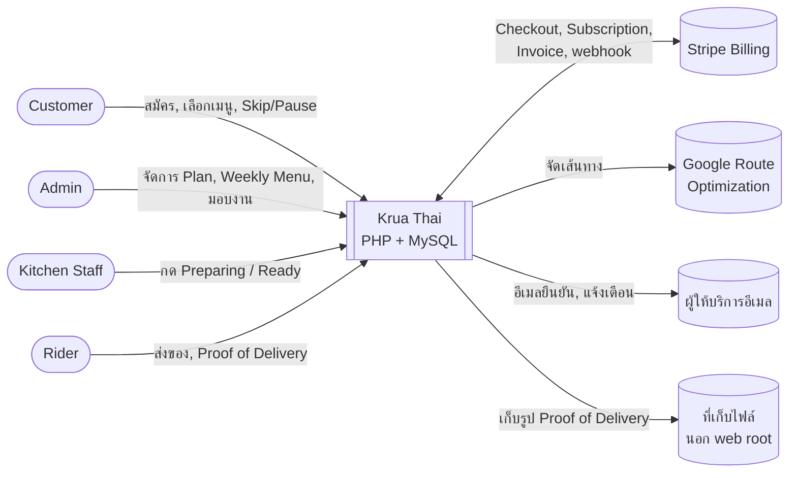
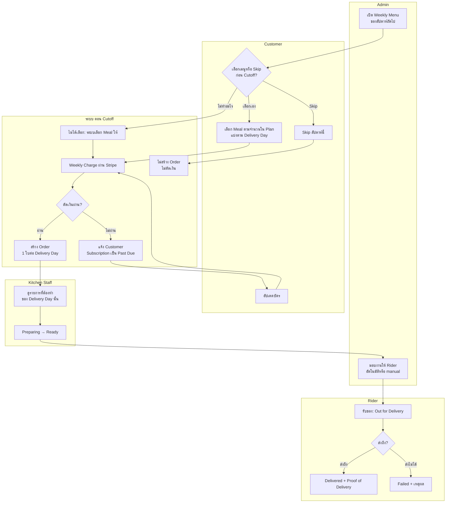
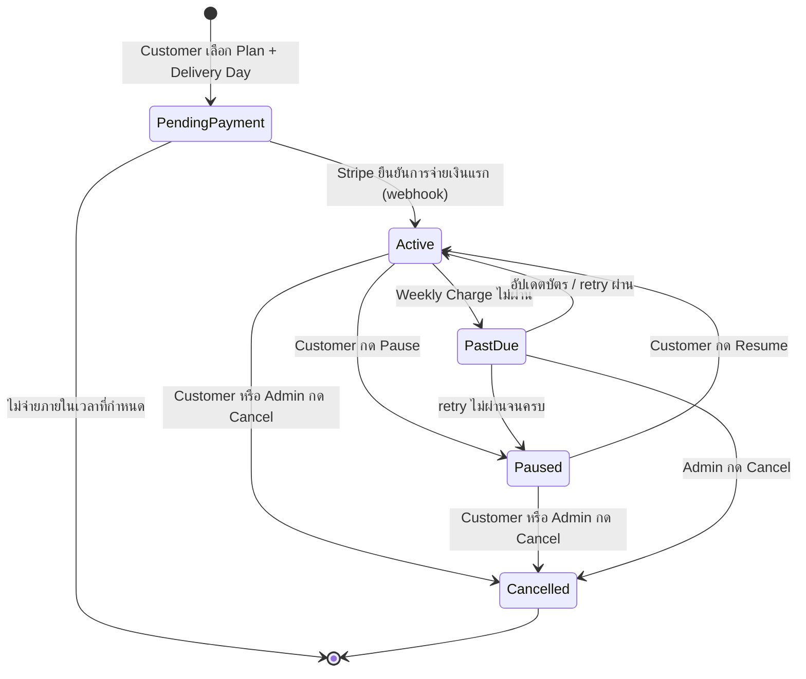
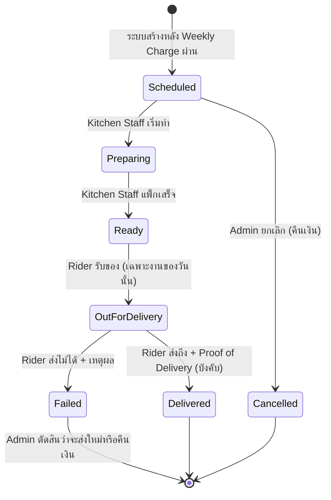
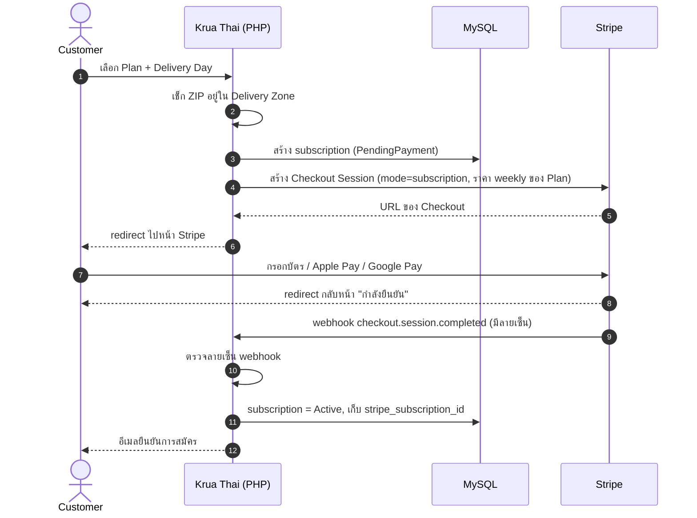
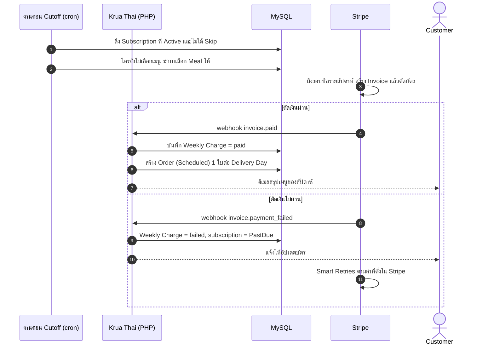
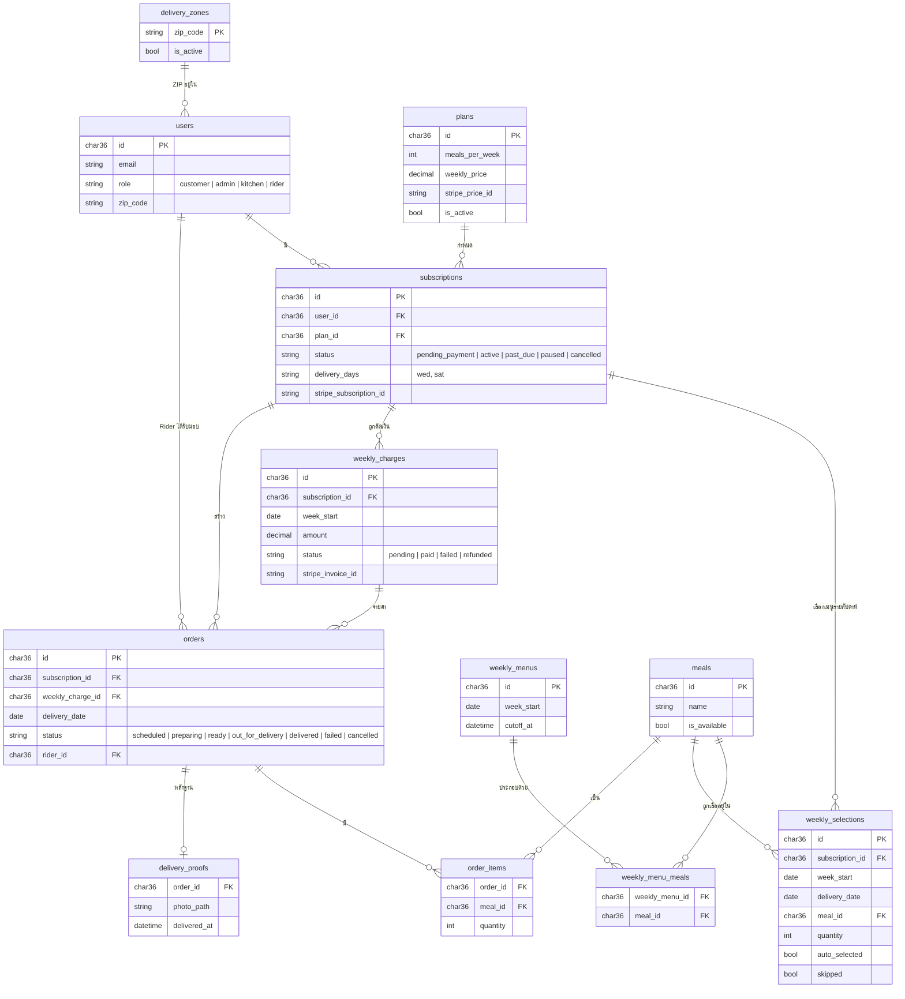
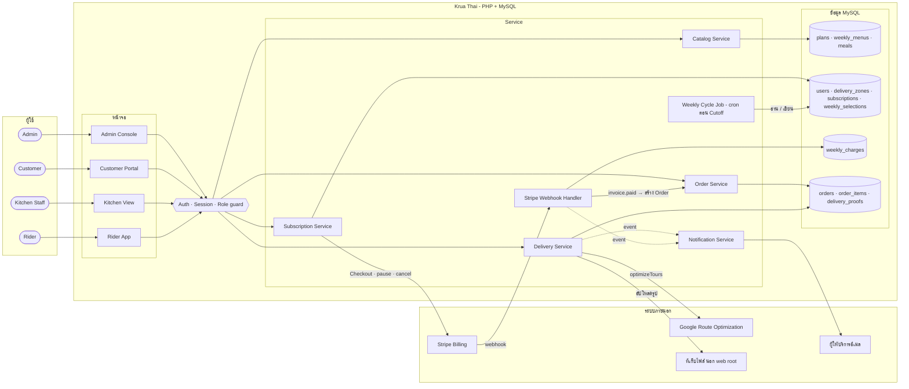

# Flow มาตรฐานของ Krua Thai (to-be)

แผนภาพชุดนี้แสดง **ระบบที่ควรเป็น** ตามโมเดลธุรกิจที่ตกลงกันแล้ว: meal subscription ใน Orange County, CA ราคาเป็น USD และตัดเงินรายสัปดาห์ผ่าน Stripe Billing ไม่ใช่สิ่งที่โค้ดทำอยู่ตอนนี้ ส่วนระบบเดิม (as-is) ดูได้ที่ [SYSTEM-MAP.md](SYSTEM-MAP.md) และความหมายของศัพท์อยู่ใน [GLOSSARY.md](../GLOSSARY.md)

ใต้แต่ละแผนภาพมีหัวข้อ **"ต่างจากโค้ดเดิม"** บอกว่าต้องสร้างหรือแก้อะไร

**ฉบับ draw.io:** [diagrams/krua-thai-flows.drawio](diagrams/krua-thai-flows.drawio) มี 7 หน้า (เปิดด้วย draw.io desktop หรือ app.diagrams.net) และมีภาพ PNG ของแต่ละหน้าอยู่ใน [diagrams/png/](diagrams/png/) ถ้าแก้แผนภาพ ให้แก้ทั้งไฟล์ draw.io และ mermaid ในหน้านี้ให้ตรงกัน

| หน้า | ภาพ |
|---|---|
| 1. System Context | [1-system-context.png](diagrams/png/1-system-context.png) |
| 2. รอบรายสัปดาห์ (Swimlane) | [2-weekly-cycle.png](diagrams/png/2-weekly-cycle.png) |
| 3. State: Subscription | [3-subscription-state.png](diagrams/png/3-subscription-state.png) |
| 4. State: Order | [4-order-state.png](diagrams/png/4-order-state.png) |
| 5. Sequence: สมัคร + Stripe | [5-seq-signup.png](diagrams/png/5-seq-signup.png) |
| 6. Sequence: ตัดเงินรายสัปดาห์ | [6-seq-weekly-charge.png](diagrams/png/6-seq-weekly-charge.png) |
| 7. ER (ฉบับที่เสนอ) | [7-er-proposed.png](diagrams/png/7-er-proposed.png) |
| 8. System Flow | [8-system-flow.png](diagrams/png/8-system-flow.png) |

## สารบัญ

1. [System Context](#1-system-context)
2. [Swimlane: รอบรายสัปดาห์](#2-swimlane-รอบรายสัปดาห์)
3. [State Machine: Subscription](#3-state-machine-subscription)
4. [State Machine: Order](#4-state-machine-order)
5. [Sequence: สมัครและตัดเงินผ่าน Stripe](#5-sequence-สมัครและตัดเงินผ่าน-stripe)
6. [ER Diagram (ฉบับที่เสนอ)](#6-er-diagram-ฉบับที่เสนอ)
7. [System Flow](#7-system-flow)

---

## 1. System Context

ระบบคุยกับใครและกับระบบภายนอกอะไรบ้าง

**ต่างจากโค้ดเดิม**
- ต้องเพิ่ม **Stripe** เพราะตอนนี้ไม่มี payment gateway เลย
- เปลี่ยนจาก Gmail ส่วนตัวไปใช้ผู้ให้บริการอีเมลธุรกรรมบนโดเมนของร้าน
- ย้ายที่เก็บรูปออกจาก web root เพื่อไม่ให้ไฟล์ที่อัปโหลดถูกรันเป็นโค้ดได้
- ตัด social login ออกจากแผนภาพไว้ก่อน เพราะตอนนี้ใช้ไม่ได้ ค่อยเพิ่มกลับเมื่อพร้อม

---

## 2. Swimlane: รอบรายสัปดาห์

หัวใจของธุรกิจ คือรอบที่วนทุกสัปดาห์ แต่ละ lane คือคนหรือระบบที่รับผิดชอบขั้นนั้น

**ต่างจากโค้ดเดิม**
- **ยังไม่มีงานที่รันตอน Cutoff เลย** (ไม่มี cron) ต้องสร้างงานที่เลือกเมนูให้, ตัดเงิน และสร้าง Order
- ตอนนี้ไม่มีการสร้าง Order ต่อ Delivery Day ระบบใช้ Subscription แทนทั้งหมด
- ตอนนี้ครัวทำได้แค่ดู และ Rider เป็นคนกดสถานะ "กำลังทำในครัว" ต้องย้ายสิทธิ์กดสถานะ Preparing / Ready มาให้ครัว
- ต้องมีทางมอบงานแบบ manual ด้วย เพราะตอนนี้ถ้าไม่มี key ของ Google ก็มอบงานไม่ได้เลย
- **Timezone ต้องเป็น `America/Los_Angeles`** ทั้งระบบ ไม่อย่างนั้นเวลา Cutoff จะคลาด

---

## 3. State Machine: Subscription

Subscription คือ**สัญญา** ส่วน Skip ไม่ใช่สถานะ เพราะเป็นการข้ามแค่สัปดาห์เดียว และ Subscription ยัง Active อยู่

| สถานะ | ตัดเงินไหม | สร้าง Order ไหม |
|---|---|---|
| PendingPayment | ยัง | ไม่ |
| Active | ทุกสัปดาห์ที่ไม่ได้ Skip | ใช่ |
| PastDue | กำลัง retry | ไม่ |
| Paused | ไม่ | ไม่ |
| Cancelled | ไม่ (สิ้นสุดถาวร) | ไม่ |

**ต่างจากโค้ดเดิม**
- ตอนนี้ Subscription เป็น `active` ทันทีโดยไม่มีการจ่ายเงินจริง
- ตอนนี้กด `renew` ได้ ซึ่งทำให้ Subscription ที่ Cancel แล้วกลับมา active **ต้องตัดออก** เพราะ Cancel คือจบถาวร ถ้าจะกลับมาต้องสมัครใหม่
- ไม่มีสถานะ PastDue
- ต้องเลิกเขียนค่า `delivered` ลงใน `subscriptions.status` เพราะค่านี้เป็นของ Order

---

## 4. State Machine: Order

Order คือ**การส่ง 1 ครั้งต่อ 1 Delivery Day** แต่ละขั้นมีคนรับผิดชอบชัดเจน

| ขั้น | คนที่กด | เงื่อนไข |
|---|---|---|
| Scheduled | ระบบ | หลัง Cutoff และ Weekly Charge ผ่าน |
| Preparing, Ready | **Kitchen Staff** | เฉพาะ Order ของ Delivery Day นั้น |
| Out for Delivery, Delivered, Failed | **Rider** ที่ได้รับมอบงาน | ปิดงานของวันอื่นไม่ได้ และ Delivered ต้องมีรูป |
| Cancelled | Admin | ก่อนเริ่มทำอาหาร |

**ต่างจากโค้ดเดิม**
- ตอนนี้ไม่มี Order แยกจาก Subscription เลย
- Rider กดได้ทุกสถานะ และกดงานของวันอื่นได้ ต้องจำกัดตามตารางด้านบน
- ไม่มีสถานะ Failed
- รูปหลักฐานตอนนี้ไม่บังคับ และช่องอัปโหลดยังไม่ปลอดภัย

---

## 5. Sequence: สมัครและตัดเงินผ่าน Stripe

แนวทางคือ **server ของเราไม่แตะข้อมูลบัตรเลย** และถือว่า webhook ของ Stripe เป็นความจริงเรื่องการจ่ายเงิน ห้ามเชื่อหน้า redirect

### 5.1 สมัคร Subscription

### 5.2 ตัดเงินรายสัปดาห์ (ตอน Cutoff)

**ข้อควรตัดสินใจตอนออกแบบจริง**
- **ตั้งรอบบิลของ Stripe ให้ตรงกับ Cutoff** (billing cycle anchor) เพื่อให้ Invoice ออกหลังเลือกเมนูเสร็จ
- **Skip:** ใช้ `pause_collection` ของ Stripe เฉพาะรอบนั้น หรือออก credit คืน
- **Pause:** ใช้ `pause_collection` แบบไม่มีกำหนด / **Cancel:** ยกเลิก subscription ใน Stripe
- webhook ต้องจัดการได้แม้ถูกส่งซ้ำ (idempotent) โดยใช้ event id ของ Stripe กันการทำซ้ำ

**ต่างจากโค้ดเดิม**
- ตอนนี้ `checkout.php` บันทึกว่าจ่ายเงินแล้วทันที โดยไม่มีการเก็บเงินจริง
- ราคาต้องมาจาก Price ของ Stripe ที่ผูกกับ Plan เท่านั้น ห้ามมี plan สำรองหรือการแปลงหน่วยราคาแบบเดา

---

## 6. ER Diagram (ฉบับที่เสนอ)

แยก **Subscription (สัญญา)** ออกจาก **Order (การส่ง)** และเพิ่มตารางของรอบรายสัปดาห์ ชื่อตารางใช้ศัพท์จาก GLOSSARY แต่ละตารางแสดงเฉพาะคอลัมน์หลัก

**ต่างจาก schema เดิม**
- **เพิ่มตาราง** `weekly_menus`, `weekly_menu_meals`, `weekly_selections`, `weekly_charges` และ `delivery_proofs`
- `orders` กลับมาเป็นตารางหลักของการส่ง โดยผูกกับ `weekly_charges`
- `menus` เปลี่ยนชื่อเป็น `meals` ให้ตรงกับศัพท์
- `subscription_plans` เหลือแค่ Plan ที่ไม่มีระยะเวลาสิ้นสุด ไม่ใช้ `weeks_duration` แล้ว
- `delivery_zones` ใช้บล็อก ZIP จริง แทนรายการที่ hardcode อยู่ในโค้ด
- `subscription_menus`, `payments` และตาราง log ของการจ่ายเงินแบบเดิม ให้ย้ายข้อมูลแล้วเลิกใช้
- `role` เหลือ 4 ค่า ตัด `support` ออก

---

## 7. System Flow

ภาพรวมการทำงานของทั้งระบบ แบ่งเป็น 5 ชั้นจากซ้ายไปขวา: ผู้ใช้ → หน้าจอ → Auth/Role guard → service → ข้อมูลและระบบภายนอก ทุก request ต้องผ่าน guard กลางก่อนถึง service

**ต่างจากโค้ดเดิม**
- **ยังไม่มี guard กลาง** ตอนนี้แต่ละหน้าเขียนการเช็กสิทธิ์เอง และมีหลายหน้าที่ไม่เช็กเลย
- ยังไม่มี Weekly Cycle Job, Stripe Webhook Handler หรือ Notification Service แยกเป็นส่วนของตัวเอง
- โค้ดเดิมเขียนแต่ละหน้าเป็นไฟล์ PHP ที่ทั้งแสดงผลและยิง SQL เองในไฟล์เดียว การแยก service ตามภาพนี้ไม่จำเป็นต้องทำทีเดียว ทยอยแยกตอนแก้แต่ละ flow ได้
