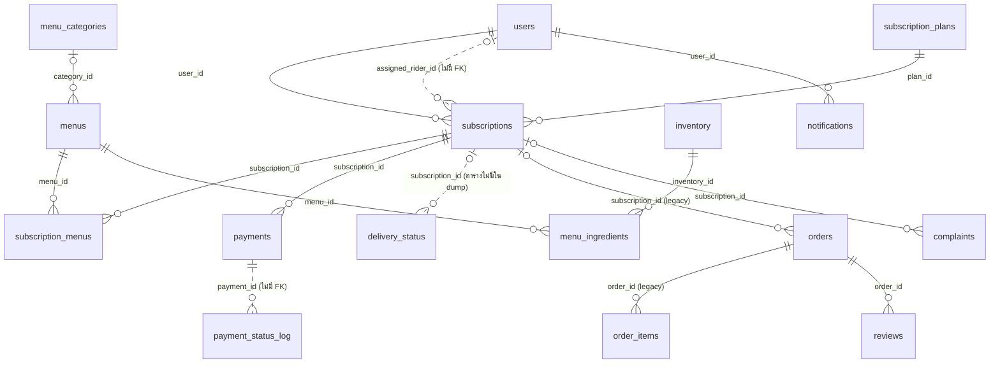
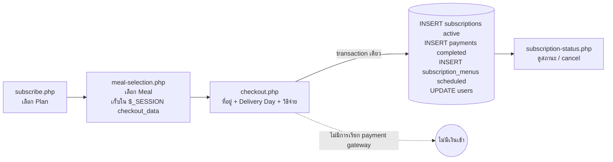
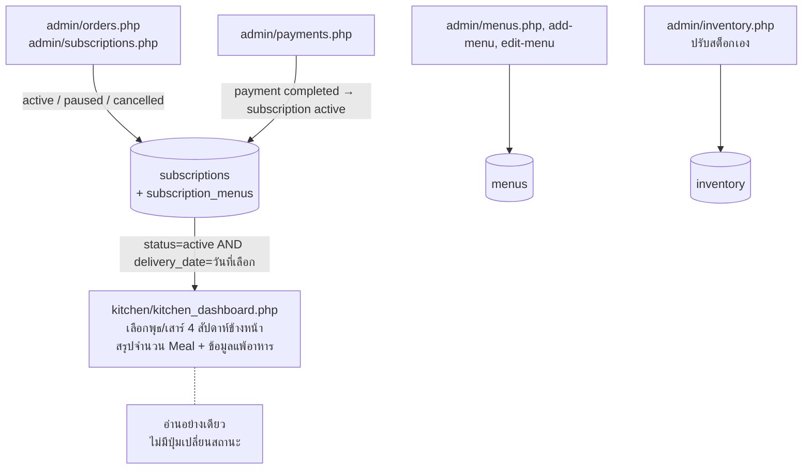
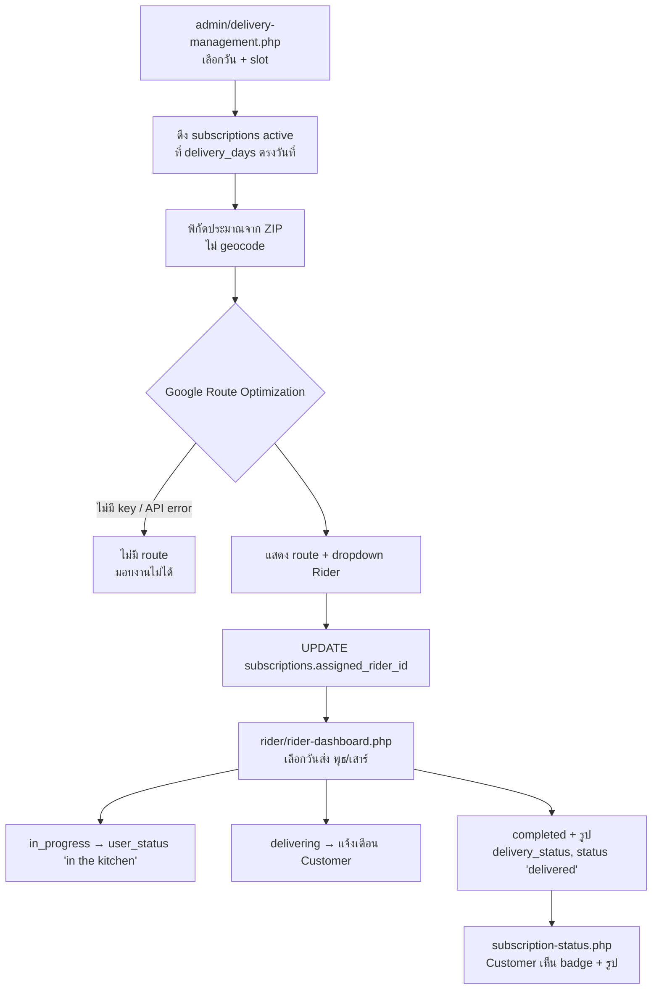

# SYSTEM-MAP: Krua Thai

เอกสารส่งต่องานสำหรับคนที่จะดูแลโค้ด Krua Thai ต่อและเตรียม deploy อ่านจบแล้วควรรู้ว่าระบบทำอะไร ข้อมูลไหลยังไง ไฟล์ไหนยังใช้อยู่ และต้องทำอะไรเพิ่มก่อนเปิดใช้จริง

- ที่มาของข้อมูล: อ่านโค้ดใน `KruaThai/` บน `main` (HEAD `8b9d908`) และ `krua_thai (19).sql` แบบ static ไม่ได้รันเว็บ (ดู [แหล่งอ้างอิง](#10-แหล่งอ้างอิง))
- ศัพท์ธุรกิจใช้ตาม [GLOSSARY.md](../GLOSSARY.md) ชื่อไฟล์ ตาราง และฟังก์ชันใช้ภาษาอังกฤษตามโค้ด ถ้าโค้ดใช้คำต่างจาก glossary จะบอกไว้ครั้งเดียวในจุดที่เจอครั้งแรก
- เอกสารนี้ตั้งใจไม่ใส่รายละเอียดช่องโหว่ ตำแหน่ง secret และข้อมูลส่วนตัว รายละเอียดทั้งหมดอยู่ใน BEFORE-DEPLOY.md ซึ่ง**ห้าม**ขึ้น repo public

## สารบัญ

1. [ภาพรวม](#1-ภาพรวม)
2. [สถาปัตยกรรมและการรัน](#2-สถาปัตยกรรมและการรัน)
3. [โมเดลข้อมูล](#3-โมเดลข้อมูล)
4. [Flow หลัก](#4-flow-หลัก)
5. [Login และสิทธิ์](#5-login-และสิทธิ์)
6. [ไฟล์ที่ใช้จริง vs ตายแล้ว](#6-ไฟล์ที่ใช้จริง-vs-ตายแล้ว)
7. [ช่องว่างระหว่างโมเดลธุรกิจกับโค้ด](#7-ช่องว่างระหว่างโมเดลธุรกิจกับโค้ด)
8. [ความเสี่ยง (สรุป)](#8-ความเสี่ยง-สรุป)
9. [คำถามที่ยังเปิดอยู่](#9-คำถามที่ยังเปิดอยู่)
10. [แหล่งอ้างอิง](#10-แหล่งอ้างอิง)

---

## 1. ภาพรวม

Krua Thai คือบริการ meal subscription อาหารไทยใน **Orange County, CA** คิดเงินเป็น USD Customer สมัคร Subscription ตาม Plan (จำนวน Meal ต่อสัปดาห์) เลือกเมนูจาก Weekly Menu หรือ Skip ก่อน Cutoff ทุกสัปดาห์ ระบบตัด Weekly Charge ผ่าน **Stripe Billing** แล้วสร้าง Order 1 ใบต่อ Delivery Day (พุธ/เสาร์) จากนั้น Kitchen Staff ทำอาหารและ Rider ไปส่งพร้อม Proof of Delivery

guest checkout และ meal kit ถูกตัดออกจากผลิตภัณฑ์แล้ว ส่วนร้านขายซอส (`product*.php`) ยังไม่ได้ตัดสินใจ

### ที่ตั้งใจไว้ vs สิ่งที่โค้ดทำอยู่ตอนนี้

| เรื่อง | ตั้งใจไว้ (โมเดลธุรกิจ) | โค้ดตอนนี้ |
|---|---|---|
| การเก็บเงิน | Stripe Billing ตัด Weekly Charge อัตโนมัติที่ Cutoff | **ไม่มี payment gateway เลย** checkout บันทึกว่าจ่ายแล้วทันที ช่องทางจ่าย (PayPal, Apple Pay ฯลฯ) เป็นแค่ปุ่มเลือก |
| Subscription | สัญญาที่ต่ออายุทุกสัปดาห์จนกว่าจะ Cancel | 1 แถวใน `subscriptions` = การซื้อครั้งเดียวสำหรับ 1 Delivery Day ไม่มีการต่ออายุ |
| Order | สร้างใหม่ทุกสัปดาห์ 1 ใบต่อ Delivery Day | **ไม่มีโค้ดที่ใช้งานอยู่สร้าง `orders` แล้ว** ทุกฝั่งทำงานจาก `subscriptions` + `subscription_menus` โดยตรง |
| Cutoff / Skip / Pause | Customer เลือกเมนูหรือ Skip ก่อน Cutoff และ Pause ได้ | ไม่มี Cutoff ฝั่ง server, ไม่มี Skip, Pause มีแค่ฝั่ง Admin และไม่ resume เอง |
| สถานะ Order | Scheduled → Preparing → Ready (Kitchen Staff) → Out for Delivery → Delivered/Failed (Rider) | ครัวดูได้อย่างเดียว Rider เป็นคนกดทุกสถานะ รวมถึง "in the kitchen" |
| Delivery Zone | ZIP ใน OC เท่านั้นที่สมัครได้ | เช็ก ZIP แค่เพื่อแสดงผล checkout รับ ZIP 5 หลักอะไรก็ได้ |
| Proof of Delivery | ต้องมีรูปทุกครั้งที่ Delivered | แนบรูปได้แต่ไม่บังคับ |
| Timezone | `America/Los_Angeles` | ใช้ `America/New_York` และ `Asia/Bangkok` ปนกัน |

ส่วนที่เป็นของไทย (ZIP กรุงเทพ, PromptPay, แผนราคาบาท, สกุลเงิน default `THB`) เป็นของเก่าที่ยังค้างอยู่ในโค้ด

---

## 2. สถาปัตยกรรมและการรัน

### Stack

| ส่วน | ใช้อะไร |
|---|---|
| ภาษา / เซิร์ฟเวอร์ | PHP 7.4 บน MAMP (Apache) ไม่มี framework ไม่มี Composer ทุกหน้าคือไฟล์ `.php` ที่ผสม HTML, SQL และ JS ไว้ด้วยกัน |
| ฐานข้อมูล | MySQL 5.7 (MAMP port 8889) InnoDB `utf8mb4_unicode_ci` ต่อทั้งแบบ PDO และ mysqli |
| อีเมล | PHPMailer (vendored ใน `includes/phpmailer/`) ส่งผ่าน Gmail SMTP |
| แผนที่ / เส้นทาง | Google Route Optimization API ผ่าน service account (OAuth2 JWT) ไม่มี Maps JS / Geocoding |
| Social login | Google / Facebook (ตอนนี้ใช้ไม่ได้ ดู [ข้อ 5](#5-login-และสิทธิ์)) |
| Notification | เขียนลง DB (`NotificationManager.php`) แสดงใน dropdown ของ `header.php` ไม่มี push/SMS |
| หน้าเว็บ | CDN: sweetalert2, font-awesome และฟอนต์จาก `ydpschool.com` (โดเมนภายนอกที่ไม่เกี่ยวข้อง) |
| PHP extensions ที่ต้องมี | `pdo_mysql`, `mysqli`, `curl`, `openssl` |

ไม่มี build step, test, migration หรือ cron ในโปรเจกต์ และไม่มี `.htaccess` ทุกไฟล์ใต้ `KruaThai/` จึงเปิดผ่าน URL ได้

### โครงสร้างโฟลเดอร์

```
Krua_Thai1/
├── krua_thai (N).sql      # SQL dump 8 ไฟล์ (ล่าสุด (19) วันที่ 13 ส.ค. 2025) มีข้อมูลผู้ใช้อยู่
└── KruaThai/              # web root ของแอป
    ├── *.php              # หน้า Customer / guest / auth (index, login, subscribe, checkout ...)
    ├── NotificationManager.php
    ├── admin/             # หน้า Admin + includes/sidebar.php
    ├── kitchen/           # kitchen_dashboard.php (+ manage_order.php ที่ตายแล้ว)
    ├── rider/             # rider-dashboard.php
    ├── ajax/              # endpoint ที่หน้าเว็บเรียก (zipcode, menu, cart, notification)
    ├── api/               # ไม่มีไฟล์ไหนถูกใช้
    ├── classes/User.php   # สมัคร / login / verify
    ├── config/            # database.php, email_config.php
    ├── includes/          # functions.php, email_functions.php, cart_functions.php, phpmailer/
    ├── assets/, Font/     # static
    ├── uploads/           # รูปที่อัปโหลด (Proof of Delivery อยู่ใน uploads/delivery_photos/)
    ├── logs/, test_emails/ # ของ dev ที่ไม่ควรอยู่ใน repo
    └── secrets/           # (ไม่อยู่ใน repo) ไฟล์ service-account ของ Google
```

### Entry point แต่ละ role

| Role (คำในโค้ด → glossary) | Entry point | ไปต่อที่ |
|---|---|---|
| Guest | `index.php` (หน้าแรกจริง) + nav ใน `header.php` | `menus.php`, `subscribe.php`, `login.php`, `register.php`, `support-center.php` |
| `customer` → Customer | `login.php` → `dashboard.php` | `subscription-status.php`, `payment_status.php`, `edit_profile.php`, `nutrition-tracking.php`, flow สมัคร `subscribe.php` → `meal-selection.php` → `checkout.php` |
| `admin` → Admin | `admin/dashboard.php` | เมนูใน `admin/includes/sidebar.php` |
| `kitchen` → Kitchen Staff | `kitchen/kitchen_dashboard.php` | – (หน้าเดียว อ่านอย่างเดียว) |
| `rider` → Rider | `rider/rider-dashboard.php` | – (หน้าเดียว) |
| `support` | ไม่มีหน้าของตัวเอง ถูกส่งไป `dashboard.php` ของ Customer | ตัดทิ้งตาม glossary |
| ลิงก์ในอีเมล | `verify_email.php`, `reset_password.php`, `check_email.php` | ไม่มีลิงก์ในเว็บ |
| Facebook data deletion | `data-deletion.php`, `privacy-policy.php`, `process-deletion.php` | น่าจะเป็น URL ที่ตั้งไว้ใน Facebook App |

`login.php` เลือกหน้าปลายทางตาม `users.role`

### ไฟล์ config และค่าที่ต้องตั้งตอน deploy (ชื่อเท่านั้น)

| ไฟล์ / ที่ตั้ง | ค่าที่ต้องมี | หมายเหตุ |
|---|---|---|
| `config/database.php` | `DB_HOST`, `DB_NAME`, `DB_USER`, `DB_PASS` | ยังถูก track ใน git ทั้งที่อยู่ใน `.gitignore` และมีอีกราว 13 ไฟล์ที่ต่อ DB เองโดยไม่ผ่านไฟล์นี้ ต้องแก้ให้ใช้ที่เดียว |
| `config/email_config.php` | ค่าของ SMTP (username, password, ชื่อผู้ส่ง) | ต้องย้ายไปไว้ใน environment / ไฟล์ที่ไม่ถูก track และควรเปลี่ยนไปใช้ผู้ให้บริการอีเมลธุรกรรมบนโดเมนของร้าน |
| `config/secrets.php` (ยังไม่มี และยังไม่มีไฟล์ไหน `require`) | `$google_client_id`, `$facebook_app_id`, `$facebook_app_secret` | ต้องตั้ง redirect URI / allowed domain ใน Google Console และ Meta ให้ตรงโดเมนจริง |
| `admin/delivery-management.php` (hardcode) | `$PROJECT_ID`, `$SERVICE_ACCOUNT_KEY_FILE` | ไฟล์ JSON ของ service account ต้องอยู่นอก web root, เปิด Route Optimization API + billing ใน GCP |
| `includes/functions.php`, `includes/email_functions.php` | base URL ของโดเมนจริง (https) | ตอนนี้ลิงก์ในอีเมล hardcode เป็น localhost / path ของ dev |
| `login.php` และหน้าอื่นราว 50 ไฟล์ | `DEBUG=false`, ปิด `display_errors` | |
| ทุกที่ที่เรียก `date_default_timezone_set` | `America/Los_Angeles` + time zone ของ MySQL session | |
| MySQL | `sql_mode` (strict + `ONLY_FULL_GROUP_BY`) | ต้องเช็กค่าจริงก่อน หลายบั๊กขึ้นกับค่านี้ |
| Stripe (ยังไม่มีในโค้ด) | secret key, webhook secret, Price ID ต่อ Plan | ดู [ข้อ 7](#7-ช่องว่างระหว่างโมเดลธุรกิจกับโค้ด) |
| ระบบไฟล์ | `uploads/delivery_photos/` ให้ web server เขียนได้ และห้ามรัน PHP ในโฟลเดอร์นี้ | |

ข้อเสนอ: รวมทุกค่าไว้ในไฟล์ config ตัวเดียวที่อ่านจาก env และไม่ commit พร้อม `.env.example` ที่ไม่มีค่าจริง

---

## 3. โมเดลข้อมูล

dump 19 มี 21 ตาราง PK เกือบทุกตารางเป็น UUID `char(36)` ที่ PHP สร้างเอง มี FK จริง 27 ตัว คอลัมน์แบบ JSON (`delivery_days`, `zip_codes`, `dietary_tags`) เก็บเป็น `longtext` ไม่มี trigger, view หรือ stored procedure

**คำในตาราง vs glossary:** `menus` = Meal, `subscription_plans` = Plan, `subscriptions` = Subscription, `subscription_menus` = Meal ที่ Customer เลือกต่อ Delivery Day, `orders` = Order (แต่ตอนนี้ไม่มีใครสร้างแล้ว), `delivery_days` / `delivery_date` = Delivery Day, `delivery_status.photo_path` = Proof of Delivery, `payments` = การจ่ายเงินต่อ Subscription (ยังไม่ใช่ Weekly Charge)

### ตารางหลักและความสัมพันธ์



| ตาราง | หน้าที่ในโค้ดตอนนี้ |
|---|---|
| `users` | ทุก role ในตารางเดียว (`role` = customer/admin/kitchen/rider/support) รวมที่อยู่ส่งของและข้อมูลแพ้อาหาร |
| `subscription_plans` | Plan: `meals_per_week`, `final_price` (`weeks_duration` ไม่ใช้แล้ว) |
| `subscriptions` | ศูนย์กลางของระบบ: Plan, `status`, `delivery_days`, `assigned_rider_id`, `user_status` และทำหน้าที่แทน Order ไปด้วย |
| `subscription_menus` | Meal ที่เลือก ต่อ `delivery_date` (ครัวอ่านตารางนี้) |
| `payments` + `payment_status_log` | บันทึกการจ่าย (ตอนนี้เป็น `completed` ทันทีโดยไม่มีเงินเข้า) และประวัติเปลี่ยนสถานะ |
| `delivery_status` | log ของ Rider ต่อ Subscription + path รูป Proof of Delivery |
| `menus`, `menu_categories`, `menu_ingredients`, `inventory` | แคตตาล็อก Meal และสต็อกวัตถุดิบ (สต็อกปรับมือ ไม่ตัดอัตโนมัติ) |
| `delivery_zones` | Delivery Zone ตามชื่อ แต่มีแต่ข้อมูลทดสอบและไม่มีโค้ดฝั่ง Customer อ่าน |
| `notifications` (+ `system_notifications`) | การแจ้งเตือนรายคนและแบบ broadcast |
| `reviews`, `complaints` | รีวิวต่อ `orders` และเรื่องร้องเรียนต่อ Subscription |

### สถานะกระจายอยู่หลายที่

| ฟิลด์ | ใครเขียน | สถานะ |
|---|---|---|
| `subscriptions.status` | checkout, Customer cancel, Admin, Rider | **ตัวคุมว่างานยังค้างไหม** (Rider เขียนค่า `delivered` ที่ไม่อยู่ใน enum) |
| `subscriptions.user_status` | Rider เท่านั้น | สิ่งที่ Customer เห็น (คอลัมน์ไม่มีใน dump) |
| `delivery_status.status` | Rider | log เสริม |
| `subscription_menus.status` | checkout (`scheduled`) | ค้างอยู่ที่ `scheduled` ตลอด |
| `orders.status`, `orders.kitchen_status` | ไม่มีใครเขียนแล้ว | ข้อมูลเก่า |

### Schema drift (dump กับโค้ดไม่ตรงกัน)

dump 19 (13 ส.ค. 2025) **ไม่ใช่ schema สุดท้าย** โค้ดแก้ต่อถึง 1 ก.ย. 2025 ถ้า import dump 19 ไปใช้ตรงๆ หลายหน้าจะ error

| ชนิด | รายการ |
|---|---|
| ตารางที่โค้ดใช้แต่ไม่มีใน dump ใดเลย (11) | `system_notifications`, `user_system_notification_reads`, `user_notifications_view`, `products`, `product_orders`, `product_order_items`, `delivery_status`, `data_deletion_requests`, `email_signups` (สร้างเองตอนรัน), `activity_logs` (มีเช็กก่อน), `order_menus` (ไฟล์ทดสอบ) |
| คอลัมน์ที่ไม่มีใน dump | `users.profile_complete`, `subscriptions.user_status` / `delivered_at`, `subscription_menus.user_status` ฯลฯ, `orders.subtotal`/`total` (guest checkout), `complaints.admin_response_email` |
| ค่านอก enum | `subscriptions.status='delivered'`, `users.status='deletion_requested'`, `preferred_time='afternoon'`, priority `urgent` |
| DDL ตอนรัน | `kitchen/manage_order.php` (ตายแล้ว) `ALTER TABLE` เพิ่ม `user_status` ซึ่งหน้า Rider พึ่งอยู่, `admin/payments.php` สร้าง `payment_status_log`, `index.php` สร้าง `email_signups` |

ถ้าไม่มี DB จริงหลัง 13 ส.ค. 2025 ต้องเขียน DDL ของ 11 ตารางนี้ขึ้นใหม่จากโค้ด

### ตารางที่ตายหรือไม่มีใครใช้

| ตาราง | เหตุผล |
|---|---|
| `payment_status_logs` | ตารางแฝดของ `payment_status_log` 0 แถว ไม่มีโค้ดอ้างถึง ทิ้งได้ |
| `daily_nutrition_tracking`, `nutrition_goals` | ไม่มี SQL อ้างถึง (`nutrition-tracking.php` คำนวณสดจาก `subscription_menus` + `menus`) |
| `orders`, `order_items` | ยังมีหน้าอ่าน (สถิติ admin, รีวิว) แต่ไม่มีใครสร้างแถวใหม่ (แถวล่าสุด 4 ส.ค. 2025) **ควรนำกลับมาใช้เป็น Order** ดู [ข้อ 7](#7-ช่องว่างระหว่างโมเดลธุรกิจกับโค้ด) |
| `cart_activities` | ใช้กับ meal kit ซึ่งตัดออกแล้ว |

ข้อควรรู้: ลบ `users` แถวเดียวจะ CASCADE ไปทุกอย่าง และลบ `menus` จะลบ `order_items`/`reviews` ที่อ้างถึงไปด้วย

---

## 4. Flow หลัก

### 4.1 สมัครและจ่ายเงิน

Customer ต้องล็อกอินก่อน (guest สมัครไม่ได้) ราคามาจาก `subscription_plans.final_price` ที่ฝากไว้ใน session ไม่ได้รับยอดเงินจาก client



- 1 Subscription = Meal ทั้งหมดใน Delivery Day เดียว Plan รายเดือนก็ได้ส่งแค่รอบเดียว
- `next_billing_date` / `auto_renew` ถูกเขียนแต่ไม่มีใครอ่าน ไม่มีงานรายสัปดาห์
- Customer ทำได้แค่ cancel (Pause มีแค่ฝั่ง Admin)
- Admin เปลี่ยนสถานะ payment เองได้ใน `admin/payments.php`

### 4.2 งานฝั่ง Admin และครัว

ในโค้ด "orders" ฝั่ง Admin หมายถึง Subscription: `admin/orders.php` จัดการ `subscriptions` (active/paused/cancelled) ไม่ใช่ตาราง `orders`



- Kitchen Staff ดูรายการได้อย่างเดียว สถานะ "in the kitchen" ถูกตั้งโดย Rider ส่วนหน้าที่ออกแบบให้ครัวใช้ (`kitchen/manage_order.php`) ตายแล้วและเปิดได้เฉพาะ Admin
- สถิติใน `admin/dashboard.php`, `reports.php`, `analytics.php` ยังนับจากตาราง `orders` ที่ไม่มีข้อมูลใหม่ ตัวเลขจึงผิด
- เมนู Orders/Users/Promotions ใน sidebar ชี้ไป `workinprogress.php` ส่วน `orders.php`/`users.php` เข้าได้จากปุ่มใน dashboard
- สต็อกไม่ถูกตัดอัตโนมัติ

### 4.3 การส่งและ Rider



- **การมอบงาน Rider ทำได้ทางเดียว** คือปุ่มใน route ที่ Google คืนมา ถ้าไม่มี service account หรือ API ใช้ไม่ได้ Admin จะมอบงานไม่ได้ (`admin/assign-riders.php` ทำงานกับ `orders` จึงใช้ไม่ได้จริง)
- รายการของ Rider **กรองตามวันที่ที่เลือก** (research 06 แก้ข้อสังเกตเดิมของ 05 ที่ว่าไม่กรอง) แต่เลือกวันในอนาคตได้ และการกดสถานะไม่เช็กวัน Rider จึงปิดงานล่วงหน้าได้ ส่วนงานของ Rider คนอื่นกดไม่ได้
- Delivery Zone ไม่ถูกบังคับที่ไหน: `ajax/check_zipcode.php` ใช้ ZIP ของ OC ที่ hardcode แค่แสดงผล, `edit_profile.php` ใช้ ZIP กรุงเทพ, ตาราง `delivery_zones` เป็นข้อมูลทดสอบ และไม่มีการคิดค่าส่ง
- หน้าพิมพ์/ส่งออกใบงาน (`print-delivery-sheets.php`, `export-routes.php`, `track-deliveries.php`) อ่านจาก `orders` และตายแล้ว **ตอนนี้ไม่มีใบงานให้พิมพ์สำหรับงานจริง**
- ชื่อ Customer ถูกส่งเป็น label ให้ Google ด้วย

---

## 5. Login และสิทธิ์

### Role

| Role ใน `users.role` | คำใน glossary | ได้มายังไง | หน้าของตัวเอง |
|---|---|---|---|
| `customer` | Customer | สมัครเอง (ค่าเริ่มต้นเสมอ) | หน้า root ที่ต้องล็อกอิน |
| `admin` | Admin | Admin ตั้งให้ใน `admin/users.php` | `admin/*` และเปิดหน้าครัวได้ |
| `kitchen` | Kitchen Staff | Admin ตั้งให้ | `kitchen/kitchen_dashboard.php` |
| `rider` | Rider | Admin ตั้งให้ | `rider/rider-dashboard.php` (Admin เปิดไม่ได้) |
| `support` | – | มีใน enum แต่ไม่มีหน้าใช้ | ตัดทิ้งตาม glossary |

### การเช็กสิทธิ์ทำงานยังไง

- **login:** `login.php` → `User::authenticate` (`classes/User.php`) ใช้ prepared statement + bcrypt (`password_hash`/`password_verify`) ถือว่าถูกต้อง ผิด 5 ครั้งล็อกบัญชี 15 นาที
- **session:** ตอน login คัดลอก `user_id` และ `user_role` ลง `$_SESSION` แล้ว**ไม่อ่าน role/status จาก DB ซ้ำ** (ยกเว้น `admin/logs.php`) การ suspend หรือลด role จึงยังไม่มีผลจนกว่า session จะหมด
- **ไม่มี middleware กลาง:** ทุกหน้าเขียนเช็กเองที่หัวไฟล์ รูปแบบมาตรฐานของ admin คือ "ไม่มี `user_id` หรือ role ไม่ใช่ `admin` → redirect ไป `login.php`" ส่วน helper `requireLogin()` / `hasRole()` ใน `includes/functions.php` มีอยู่แต่ไม่มีหน้าไหนเรียก
- หน้า Customer เช็กแค่ว่าล็อกอิน (role อื่นเปิดได้ด้วย ซึ่งยอมรับได้)
- มี CSRF token แค่หน้าเดียว (`admin/orders.php`) และไม่มี `session_regenerate_id` หรือ cookie flags
- ลิงก์ยืนยันอีเมลและลิงก์ reset password ยังผูกกับ URL ของเครื่อง dev ต้องตั้ง base URL ก่อน deploy
- Social login (Google/Facebook) ใช้ไม่ได้ เพราะไม่มีค่า client/app ID และใช้ `str_contains` ซึ่ง fatal บน PHP 7.4

### หน้าที่ยังไม่ป้องกันสิทธิ์

มีหลายหน้าใน `admin/`, `api/` และไฟล์ setup/test/debug ที่ไม่เช็ก login หรือ role และบางฟอร์มของ Customer ไม่เช็กว่าเป็นเจ้าของข้อมูล รายชื่อหน้าและวิธีแก้อยู่ในรายการ "สิ่งที่ต้องแก้ก่อน deploy" ซึ่งเก็บไว้นอก repo

---

## 6. ไฟล์ที่ใช้จริง vs ตายแล้ว

จาก 127 ไฟล์ `.php` ที่ track ใน git (ไล่ลิงก์จาก `index.php` + `login.php` แบบ static "ตาย" แปลว่าไม่พบที่ไหนลิงก์มา ไม่ได้แปลว่าไม่มีใครเปิดตรงๆ)

| กลุ่ม | จำนวน |
|---|---|
| live (รวมแบบเข้าได้ทางเดียวผ่าน nav เก่า, redirect, ลิงก์ภายนอก และไฟล์ include) | ~85 |
| dead | 26 |
| ไฟล์ว่าง 0 byte | 3 (`about.php` ที่ยังถูกลิงก์, `api/push-notifications.php`, `includes/notification-system.php`) |
| test / debug | 10 |

### ไฟล์ตายและไฟล์ซ้ำที่ควรรู้

| ไฟล์ | สถานะ | หมายเหตุ |
|---|---|---|
| `Home.php` | dead | landing เก่า หน้าแรกจริงคือ `index.php` |
| `home2.php`, `contact.php` | redirect | ไป `index.php` / `support-center.php` แต่ยังมี 16 ไฟล์ลิงก์ `home2.php` |
| `Notifications.php` | dead | ใช้ dropdown ใน `header.php` + `ajax/*notification*` แทน |
| `product_old.php` | dead | ถูกแทนด้วย `product.php` |
| `add_to_cart.php` (root) | dead | ใช้ `ajax/add_to_cart.php` แทน |
| `order-history.php`, `order-detail.php` | dead | schema เก่า |
| `meal-planner.php`, `confirmation.php`, `maintenance.php` | dead | `maintenance_mode` ใน settings ไม่ได้ต่อกับหน้านี้ |
| `payment.php` | dead | mock สุ่มผลการจ่ายเงิน |
| `admin_users.php` + `includes/header.php`/`footer.php` | dead | ซ้ำกับ `admin/users.php` |
| `includes/zone-helper.php` | dead | copy ของ `ajax/check_zipcode.php` |
| `ajax/cart_actions.php` | dead | |
| `api/subscription_actions.php` | dead | ต้องลบ |
| `profile.php` | live (อ่อน) | ซ้ำกับ `edit_profile.php` |
| `admin/edit-order.php`, `admin/print-order.php` | dead | |
| `admin/charts.php` | dead | ลิงก์จากไฟล์ทดสอบเท่านั้น |
| `admin/zones.php` | dead | ซ้ำกับ `admin/delivery-zones.php` (live อ่อน) |
| `admin/track-deliveries.php`, `export-routes.php`, `print-delivery-sheets.php` | dead | อ่านจาก `orders` |
| `admin/assign-riders.php` | live (อ่อน) แต่ใช้ไม่ได้จริง | ทำงานกับ `orders` |
| `admin/route-optimizer.php` | dead | รุ่นเก่าของ `delivery-management.php` |
| `admin/generate_orders.php` | dead | สร้าง `orders` เสาร์/อาทิตย์ (ไม่ตรงวันส่งพุธ/เสาร์) |
| `kitchen/manage_order.php` | dead | เปิดได้เฉพาะ Admin และแก้ schema ตอนรัน |
| `admin/js/delivery-management.js`, `admin/css/delivery-management.css` | dead | หน้าใช้ JS/CSS แบบ inline |
| `meal-kits.php`, `guest-checkout.php`, `order-confirmation.php` | live (อ่อน) | ถูกตัดออกจากผลิตภัณฑ์ ต้องลบทั้งชุด |

test/debug ที่ต้องเอาออกก่อน deploy: `debug_checkout.php`, `debug_nutrition.php`, `fix_nutrition_data.php`, `manual_verify.php`, `setup_email.php`, `test_connection.php`, `test_db.php`, `test_emails.php`, `test_simple_email.php`, `admin/test_charts.php` รวมถึงโฟลเดอร์ `logs/` และ `test_emails/`

ลิงก์ที่ชี้ไปไฟล์ที่ไม่มีอยู่: `../auth/logout.php`, `/api/newsletter_signup.php`, `check_session.php`, `test_email_ajax.php`, `ajax/search_users.php` และชื่อไฟล์ที่ตัวพิมพ์ไม่ตรง (จะ 404 บน Linux)

---

## 7. ช่องว่างระหว่างโมเดลธุรกิจกับโค้ด

flow ที่ระบบควรเป็น (to-be) ดูที่ [FLOWS.md](FLOWS.md)

สิ่งที่ต้องสร้างใหม่ (ไม่ใช่แค่แก้บั๊ก) เพื่อให้โค้ดตรงกับโมเดลใน [GLOSSARY.md](../GLOSSARY.md):

| # | ต้องสร้าง | ตอนนี้มีอะไร | แนวทาง | อ้างอิง BEFORE-DEPLOY |
|---|---|---|---|---|
| 1 | **Stripe Billing** (Weekly Charge) | ไม่มี gateway, checkout ตั้ง `payments.status='completed'` เอง | สร้าง Stripe Customer + Subscription ต่อ Plan (Price ID รายสัปดาห์) ตอน checkout ให้ Subscription เริ่มที่ `pending_payment` และเปลี่ยนเป็น `active` จาก webhook (`invoice.paid` / `invoice.payment_failed`) ลบ fallback plan และฟังก์ชันเดาหน่วยราคา | M1, M2, C6 |
| 2 | **สร้าง Order รายสัปดาห์** | ไม่มี cron, ไม่สร้าง `orders` แล้ว, `subscriptions` ถูกใช้แทน Order | กลับไปใช้ `orders` + `order_items` เป็น Order 1 ใบต่อ Delivery Day ที่ job ตอน Cutoff สร้าง ย้าย `assigned_rider_id`, สถานะ และ Proof of Delivery ไปไว้ที่ Order ให้ Subscription เหลือแค่ active/paused/cancelled | M5, D6, D7 |
| 3 | **Cutoff / Skip / Pause** | ปุ่ม cancel ซ่อนหลัง cutoff แค่ใน UI, ไม่มี Skip, Pause มีแค่ Admin และไม่ resume เอง, `skip_dates`/`pause_end_date` ไม่มีใครอ่าน | กำหนด Cutoff ต่อสัปดาห์ฝั่ง server, หน้าให้ Customer เลือก Meal หรือ Skip ก่อน Cutoff (ไม่เลือก = ระบบเลือกให้), Pause ผ่าน pause collection ของ Stripe, Cancel มีผลตอนจบรอบ และเอา `renew` ออก | M3, M5, M6, M7 |
| 4 | **สถานะฝั่งครัว** | ครัวอ่านอย่างเดียว, Rider เป็นคนตั้ง "in the kitchen" | ให้ Kitchen Staff กด Scheduled → Preparing → Ready บน Order (เอาแนวคิดจาก `kitchen/manage_order.php`) และใช้สถานะชุดเดียวตาม glossary แทน `status` / `user_status` / `kitchen_status` ที่ซ้อนกัน | D4, D6, D15 |
| 5 | **บังคับ Delivery Zone** | ZIP 3 ชุดไม่ตรงกัน (OC hardcode, กรุงเทพ hardcode, ตารางทดสอบ) ไม่มีที่ไหนบล็อก | ใช้ `delivery_zones` (ZIP ของ OC) เป็นแหล่งเดียว เช็กฝั่ง server ตอนสมัครและ checkout ลบ list กรุงเทพ ถ้ามีค่าส่งให้เป็น line item ใน Stripe | M8 |
| 6 | **Proof of Delivery** | แนบรูปได้แต่ไม่บังคับ, ตาราง `delivery_status` ไม่มี DDL, การอัปโหลดไม่ปลอดภัย | บังคับรูปตอนเปลี่ยน Order เป็น Delivered, เพิ่มสถานะ Failed, ตรวจไฟล์ฝั่ง server, เก็บไฟล์นอก web root และเช็กว่าเป็นงานของวันนั้น | S1, D2, D11 |
| 7 | **Timezone** | `America/New_York` และ `Asia/Bangkok` ปนกัน | ตั้ง `America/Los_Angeles` ที่เดียวใน bootstrap และตั้ง time zone ของ MySQL session ให้ตรง (Cutoff และ Delivery Day ขึ้นกับค่านี้) | C5 |
| 8 | **มอบงาน Rider แบบไม่พึ่ง Google** | มอบงานได้เฉพาะเมื่อ Route Optimization ทำงาน และพิกัดเป็นค่าประมาณ | เพิ่มทางมอบงานเองต่อ Order และ geocode ที่อยู่จริงถ้ายังใช้ optimizer | D10 (รอตัดสินใจ) |
| 9 | **ใบงานพิมพ์ / สถิติ** | อ่านจาก `orders` ที่ตายแล้ว | สร้างใหม่จาก Order หลังทำข้อ 2 | D13, L4 |
| 10 | **ลบส่วนที่ตัดออก** | guest checkout, meal kit, ร่องรอยไทย (THB, PromptPay, แผนบาท) | ลบทั้งชุด (ไม่ต้องแก้บั๊ก) | L1, M10 |

ลำดับที่แนะนำ: แก้ P0 ด้าน security ก่อน → schema จริง (ข้อ 9 ด้านล่าง) → ข้อ 2 (Order) → ข้อ 1 + 3 (Stripe + Cutoff) → ข้อ 4–6 → ส่วนที่เหลือ

---

## 8. ความเสี่ยง (สรุป)

รายการเต็มพร้อมตำแหน่งในโค้ดและวิธีแก้เก็บไว้นอก repo ส่วนนี้สรุปแค่จำนวน

| กลุ่ม | P0 | P1 | P2 | รวม |
|---|---|---|---|---|
| Security | 9 | 7 | 4 | 20 |
| เงิน / การจ่ายเงิน | 3 | 6 | 1 | 10 |
| ข้อมูลและ schema | 0 | 12 | 7 | 19 |
| Config และ environment | 0 | 6 | 2 | 8 |
| โค้ดตายและลิงก์เสีย | 0 | 1 | 5 | 6 |
| Privacy / ความสะอาดของ repo | 4 | 1 | 1 | 6 |
| **รวม** | **16** | **33** | **20** | **69** |

- **P0** ต้องแก้ก่อนเปิดสู่สาธารณะทุกกรณี · **P1** ทำให้ flow Subscription รายสัปดาห์พังหรือข้อมูลผิด · **P2** งานเก็บกวาด

ลำดับการแก้และรายละเอียดของแต่ละข้อเก็บไว้นอก repo เพราะ repo นี้เคยเป็น public

สิ่งที่เจ้าของระบบต้องทำเองนอกโค้ด: เปลี่ยน credential ที่เคยถูก commit, ตัดสินใจว่าจะตั้ง repo เป็น private หรือ purge history และตรวจสิทธิ์ของ service account ใน GCP

---

## 9. คำถามที่ยังเปิดอยู่

| # | คำถาม | กระทบอะไร |
|---|---|---|
| 1 | **มี DB จริงหลัง 13 ส.ค. 2025 ไหม** ถ้าไม่มีต้องเขียน DDL ของ 11 ตารางที่หายไปขึ้นใหม่จากโค้ด และ MySQL ที่ใช้ตั้ง `sql_mode` แบบ strict / `ONLY_FULL_GROUP_BY` หรือเปล่า (ต้องรันจริง) | ข้อ "ต้องตรวจกับ DB จริง" ใน BEFORE-DEPLOY ทั้งหมด |
| 2 | **เวอร์ชัน PHP ตอน deploy** 7.4 หรือ 8.x (บน 7.4 social login และ `complete-profile.php` พัง) | social login, การเลือก hosting |
| 3 | **มอบงาน Rider แบบ manual** จะพึ่ง Google Route Optimization ต่อ หรือเพิ่มทางมอบงานเอง | ข้อ 7.8, ค่าใช้จ่าย GCP |
| 4 | **ร้านขายซอส (`product_orders`)** จะเก็บไว้ไหม ถ้าเก็บถือเป็น Order อีกชนิดหรือเปล่า | schema `products*`, ต้องต่อ Stripe เพิ่ม |
| 5 | **ประวัติ git มีข้อมูลส่วนตัว** จะ purge history หรือแค่ตั้ง repo เป็น private | การ commit เอกสารนี้และ GLOSSARY |
| 6 | **ฟอนต์จาก `ydpschool.com`** (27 ไฟล์) เป็นของใคร จะ host เองหรือเปลี่ยน | ความเสถียรของหน้าเว็บ, privacy |
| 7 | **ลิงก์เสีย** และหน้า `about.php` ที่ว่าง จะเขียนเนื้อหาหรือเอาลิงก์ออก | งานเก็บกวาด |
| 8 | **ส่วนรอง** nutrition tracking, blog, reviews/complaints และระบบ notification (commit ล่าสุดยังแก้อยู่) จะเก็บไว้ตอนเปิดตัวไหม | ขอบเขตงาน |
| 9 | **บริการภายนอก** อีเมล (จะเลิกใช้ Gmail ส่วนตัวไหม), Google APIs และ push notification | config ตอน deploy |

---

## 10. แหล่งอ้างอิง

- ศัพท์ธุรกิจ: [GLOSSARY.md](../GLOSSARY.md)
- บันทึกการวิจัย 01–07, ticket การตัดสินใจ 01–11 และรายการ "สิ่งที่ต้องแก้ก่อน deploy" ฉบับเต็ม (69 ข้อ พร้อม file:line) เก็บไว้ในเครื่องของผู้ดูแล ไม่ commit ขึ้น repo เพราะมีรายละเอียดช่องโหว่
